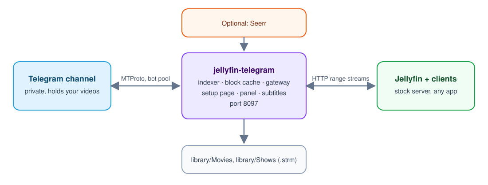

<p align="center">
  
</p>

<p align="center">
  <a href="go.mod"></a>
  <a href="LICENSE"></a>
  
  <a href="CONTRIBUTING.md"></a>
</p>

# jellyfin-telegram

Use a private Telegram channel as the storage for your Jellyfin library, with **stock Jellyfin**:
no fork, no plugin, no custom client.

Jellyfin sees a normal library of `.strm` files. Each file points at one message in your channel.
When you press play, this service reads the video from Telegram through a pool of bots and hands
it to Jellyfin as an ordinary HTTP stream, with seeking.

<p align="center">
  <a href="https://aryanmoradi.com/work/jellyfin-telegram">
    
  </a>
</p>

New here? [This page explains what jellyfin-telegram is](https://aryanmoradi.com/work/jellyfin-telegram),
with the full video. Feel free to contribute: see [Contributing](#contributing).

<p align="center">
  
</p>

It is one binary for Windows and Linux. It needs no CGO, no FUSE and no database server.

## Quick start (about two minutes)

You do not need Go, Git, Node or a terminal full of steps. One command installs it, starts it at
every login and opens the setup page. There you type your **phone number** and the code Telegram
sends you. The channel, the bots and Jellyfin are created and configured for you.

**Windows.** Download [`install-windows.cmd`](https://github.com/Aryan-mor/jellyfin-telegram/releases/latest/download/install-windows.cmd)
and double-click it. That is the file to get. Or paste this in PowerShell:

```powershell
irm https://github.com/Aryan-mor/jellyfin-telegram/releases/latest/download/install.ps1 | iex
```

To install it yourself, download [`jellyfin-telegram-windows-amd64.zip`](https://github.com/Aryan-mor/jellyfin-telegram/releases/latest/download/jellyfin-telegram-windows-amd64.zip)
from the [latest release](https://github.com/Aryan-mor/jellyfin-telegram/releases/latest). Unpack
it into an empty folder and run `jellyfin-telegram.exe`. The setup page opens by itself.

**Linux.** Paste this in a terminal. That is the file to get:

```shell
curl -fsSL https://github.com/Aryan-mor/jellyfin-telegram/releases/latest/download/install.sh | sh
```

To install it yourself, download the archive for the machine from the
[latest release](https://github.com/Aryan-mor/jellyfin-telegram/releases/latest), unpack it into an
empty folder and run `./jellyfin-telegram`. The setup page opens by itself.

- A normal PC: [`jellyfin-telegram-linux-amd64.tar.gz`](https://github.com/Aryan-mor/jellyfin-telegram/releases/latest/download/jellyfin-telegram-linux-amd64.tar.gz)
- A Raspberry Pi or other ARM64 machine: [`jellyfin-telegram-linux-arm64.tar.gz`](https://github.com/Aryan-mor/jellyfin-telegram/releases/latest/download/jellyfin-telegram-linux-arm64.tar.gz)

**Nightly.** Same installers, but the build is the nightly one. A nightly install only offers newer
nightlies. A stable install only offers stable releases. Run the installer again to update; it
stays on the channel it was installed with.

Windows: download [`install-nightly-windows.cmd`](https://github.com/Aryan-mor/jellyfin-telegram/releases/latest/download/install-nightly-windows.cmd)
and double-click it. Linux:

```shell
curl -fsSL https://github.com/Aryan-mor/jellyfin-telegram/releases/latest/download/install.sh | JFTG_CHANNEL=nightly sh
```

The installer also puts a **jellyfin-telegram panel** shortcut on your Desktop (and in the Start
menu or applications menu). Click it any time to open the panel.

When the setup page finishes, Jellyfin is at `http://127.0.0.1:8097` and the panel is at
`http://127.0.0.1:8097/panel`.

**Updates.** A release is published when someone runs `pnpm release:stable` or
`pnpm release:nightly`. Stable versions are `1.0.N`. Nightly versions are `1.0.N-nightly.K` and
do not move the stable download. The panel shows a blue bar only for a newer build on the same
channel. To update, run the same install command again: your settings and library are kept.

**Something went wrong?** See [Troubleshooting](docs/TROUBLESHOOTING.md): every common error
message and what to do. Everything else in this file is optional detail.

## Features

- Stock Jellyfin: any official client works, nothing to patch
- Parallel bot pool for fast reads, with HTTP range support and seeking
- Zero-config setup page that downloads and configures a private Jellyfin for you
- Everything on one port (8097): Jellyfin, streams, setup page and web panel
- Automatic Movies/Shows naming with TMDB matching
- Subtitle detection, online fetching and one-time extraction of embedded tracks
- Optional Seerr, Fladder, torrent download chain, channel forwarding and local media upload
## Contents

- [Features](#features)
- [What you get](#what-you-get)
- [Requirements](#requirements)
- [Quick start](#quick-start-about-two-minutes)
- [Install from source](#install) ([Windows](#windows), [Linux](#linux), [Docker for the extras](#docker-for-the-extras))
- [First run and setup](#first-run-and-setup)
- [Using the panel](#using-the-panel)
- [Using your own Jellyfin](#using-your-own-jellyfin)
- [Opening it from another device](#opening-it-from-another-device)
- [Settings reference](#settings-reference)
- [How files are named](#how-files-are-named)
- [Subtitles](#subtitles)
- [Optional extras](#optional-extras)
- [Commands](#commands)
- [Limits](#limits)
- [Development](#development)
- [Contributing](#contributing)
- [Security](#security)
- [License](#license)
- [Thanks](#thanks)

## What you get

**Core**

- **Stock Jellyfin over Telegram.** Upload videos to a private channel and they appear in
  Jellyfin with posters, metadata and seeking. Nothing is stored on your disk except a small
  block cache.
- **Bot pool for speed.** You give any number of bots, each an admin of the channel. Blocks are
  read from all bots in parallel, so more bots mean more throughput.
- **Managed Jellyfin.** With no settings at all the program opens a setup page, downloads the
  official Jellyfin 12.4, runs it privately on loopback, creates the Movies and Shows libraries
  and signs you in. Or point it at a Jellyfin you already run.
- **One port.** Jellyfin, the streams, the setup page and the panel are all served on port 8097.
- **Automatic naming.** File names and captions become `Movies/Name (Year)` and
  `Shows/Name/Season 01`, with TMDB matching. A TMDB id in the caption gives an exact match.
  Home videos with no match get a `movie.nfo` and the Telegram thumbnail as poster.
- **Subtitles in any language.** Tracks are detected from the first bytes of each file. Missing
  ones are fetched online and embedded ones are extracted once, kept in the channel and reused.
  You pick your language with one setting.
- **Web panel.** Add bots, change the channel, see the library, and follow the steps to open
  Jellyfin from another network.

**Optional extras** (all off by default)

| Extra | What it does | Needs |
|---|---|---|
| Fladder | A nicer Jellyfin web client at `/fladder/` | Docker |
| Seerr | Request films and shows from a web page, at `/seerr/` | Docker |
| Downloads | Seerr request, then Radarr/Sonarr, Bitmagnet and qBittorrent fetch it, then a Telegram account uploads it to your channel and the disk copy is deleted | Docker, a Telegram user account |
| Channels | Forward films and series from other Telegram channels into your library channel, server side, with nothing downloaded here | A Telegram user account |
| Local media | List videos already on this computer, upload the ones you pick, optionally delete the local copy afterwards | Nothing extra |

## Requirements

With the Quick start and **Automatic** setup you only need a Telegram account (your phone number).
The list below is what Manual setup needs, and the setup page creates all of it for you otherwise.

- A **private Telegram channel** that holds your videos
- **One or more bots** from [@BotFather](https://t.me/BotFather). Every bot must be an **admin**
  of that channel, with permission to post (used for subtitle archives).
- `api_id` and `api_hash` from [my.telegram.org](https://my.telegram.org) under *API development tools*
- **Go 1.26 or newer**, only to build from source
- Jellyfin **10.11.8** or **12.4** (the tested versions). The managed mode downloads 12.4 for you.
- **Docker**, only for Fladder, Seerr and Downloads. Jellyfin alone does not need it.
- Optional: `ffprobe` for subtitle detection. The service looks in `PATH` and in the Jellyfin
  install folder, so the managed Jellyfin usually covers it.

### Telegram preparation, step by step

Skip this if you use **Automatic** setup (phone number only). It is for the Manual way.

1. Create a private channel in Telegram.
2. Talk to [@BotFather](https://t.me/BotFather), send `/newbot` and keep the token. Repeat for
   as many bots as you want.
3. Open the channel, then *Administrators > Add administrator*, and add every bot.
4. Go to [my.telegram.org](https://my.telegram.org), sign in, open *API development tools* and
   create an app to get `api_id` and `api_hash`.
5. Copy a link to any message in the channel (right click > *Copy Message Link*). The channel
   setting accepts that link or the numeric id.

## Install

The [Quick start](#quick-start-about-two-minutes) above is the normal way to install. This section
is for building from source, which needs Go, and for running it as a system service. The installer
already sets up start-at-login: a Task Scheduler task on Windows, a systemd user service on Linux.

### Windows

1. Install [Go](https://go.dev/dl/) (1.26 or newer) and [Git](https://git-scm.com/download/win).
2. In PowerShell:

   ```powershell
   git clone https://github.com/Aryan-mor/jellyfin-telegram.git
   cd jellyfin-telegram
   go build -o jellyfin-telegram.exe ./cmd/jellyfin-telegram
   .\jellyfin-telegram.exe
   ```

3. Windows may ask to allow the program through the firewall the first time another device
   connects. Allow it on private networks.
4. Optional, for the extras: install [Docker Desktop](https://www.docker.com/products/docker-desktop/)
   and leave it running.

To start it automatically at logon, create a Task Scheduler task that runs
`jellyfin-telegram.exe serve` with the project folder as the start directory. The service does
not start by itself after a reboot.

### Linux

1. Install Go 1.26 or newer (from [go.dev/dl](https://go.dev/dl/) or your package manager) and git.
2. Build and run:

   ```shell
   git clone https://github.com/Aryan-mor/jellyfin-telegram.git
   cd jellyfin-telegram
   go build -o jellyfin-telegram ./cmd/jellyfin-telegram
   ./jellyfin-telegram
   ```

3. Optional, to keep it running across reboots, a systemd unit. Adjust the user and paths:

   ```ini
   # /etc/systemd/system/jellyfin-telegram.service
   [Unit]
   Description=jellyfin-telegram
   After=network-online.target docker.service
   Wants=network-online.target

   [Service]
   User=media
   WorkingDirectory=/opt/jellyfin-telegram
   ExecStart=/opt/jellyfin-telegram/jellyfin-telegram serve
   Restart=on-failure

   [Install]
   WantedBy=multi-user.target
   ```

   ```shell
   sudo systemctl daemon-reload
   sudo systemctl enable --now jellyfin-telegram
   ```

4. Optional, for the extras: install Docker and add the service user to the `docker` group.

The program reads `.env` and writes `data/` and `library/` in its working directory, so always run
it from the same folder (or pass `-env /path/to/.env`).

### Docker for the extras

Fladder, Seerr and the whole download chain run as containers that the program starts and stops
for you. You only need a working Docker. Turning an extra off removes its containers and leaves
playback alone.

## First run and setup

### The easy way: the setup page

1. Start the program with an empty folder:

   ```shell
   ./jellyfin-telegram          # Windows: .\jellyfin-telegram.exe
   ```

2. Open the address it prints. It looks like `http://127.0.0.1:8097/setup?code=...`, where the code
   is one-time and different on every start. A browser tab usually opens by itself.
3. Choose **Automatic** or **Manual**.
   - **Manual**: enter `api_id`, `api_hash`, the channel link and your bot tokens.
   - **Automatic**: sign in with your phone number (a code arrives in your Telegram app). If you
     set up a channel before, give a link to one message in it: the bots of yours that are admins
     there are found through @BotFather and reused. If not, a private channel and the number of
     bots you pick (3 by default) are created and made admins for you. The account stays signed in
     for downloads, Channels and the shared library. Sign-in is allowed only from this computer
     or over Tailscale. It uses the `api_id` built into your build; under *Advanced* you can
     enter your own. Build with `-ldflags "-X github.com/Aryan-mor/jellyfin-telegram/internal/config.DefaultAPIID=... -X github.com/Aryan-mor/jellyfin-telegram/internal/config.DefaultAPIHash=..."`
     to ship one.

   The page then checks every bot against the channel and writes `.env` for you.
4. Wait while it downloads Jellyfin 12.4, starts it, creates the libraries and signs in. The
   Jellyfin password is saved in `DATA_DIR/jellyfin/credentials.json`.
5. After setup, `http://127.0.0.1:8097` is Jellyfin and `http://127.0.0.1:8097/panel` is the panel.

Upload a video to the channel and within about a minute it is in your library.

### The manual way: `.env`

1. Copy `.env.example` to `.env`.
2. Fill in at least:

   ```ini
   TELEGRAM_API_ID=123456
   TELEGRAM_API_HASH=your_api_hash
   TELEGRAM_CHANNEL_ID=https://t.me/c/1234567890/5
   TELEGRAM_BOT_TOKENS=111:AAA...,222:BBB...
   SUBTITLE_LANGUAGE=en
   ```

3. Check the setup. This reports each bot, the channel contents, the gateway URL and Jellyfin,
   and changes nothing:

   ```shell
   jellyfin-telegram check
   ```

4. Optionally measure speed with one bot and with all of them:

   ```shell
   jellyfin-telegram bench -bots 1
   jellyfin-telegram bench
   ```

5. Start it:

   ```shell
   jellyfin-telegram serve
   ```

## Using the panel

Open `http://127.0.0.1:8097/panel` on the machine that runs the service. The panel is plain HTTP,
so it accepts sign-in from this computer or over Tailscale.

The pages are a React app in `web/`. Building it writes `internal/webui/dist`, and that folder is
embedded in the Go binary, so `go build` does not need Node. Commit the built files with the
source change. From the project folder:

| Command | What it does |
|---|---|
| `npm run setup` | Installs the UI packages once |
| `npm run restart` | Builds the UI, builds the program, stops the running one and starts the new one |
| `npm run ui:dev` | Runs the UI with live reload (the program must be running) |
| `npm run ui:build` | Builds the UI into `internal/webui/dist` |
| `npm run check` | Type-checks and lints the UI, then runs `go vet` and `go test` |

| Page | Use it to |
|---|---|
| Overview | See the addresses, the apps, and whether a restart is waiting |
| Sign in details | Copy the Jellyfin, Seerr and Fladder passwords |
| Main channel | Change the library channel |
| Mirrors | Create a channel, or add one you already have, and choose what is copied there |
| Shared library | Share the library with another group |
| Home videos | Send videos from a folder on this computer |
| Subtitles | Choose subtitle languages, in the order you want them |
| Accounts | Sign in the Telegram user accounts used by Torrents, Channels and Local files |
| Bots | Create a bot here, or paste a token. A new bot connects on the next start |
| API | Change `api_id` and `api_hash` |
| Direct files | Copy films and series from other Telegram channels |
| News | Watch channels that post a bot link instead of the film |
| Local files | Add folders of videos on this computer and upload what you choose |
| Torrents | Turn on the download chain (Radarr, Sonarr, qBittorrent, Bitmagnet) |
| Away from home | Follow the steps to reach Jellyfin from another network |

Local files stays hidden until that feature is on. Direct files, News and Torrents stay hidden
until a Telegram account is signed in. Creating a mirror or a bot, and making a mirror public
or private, only work from this computer or over Tailscale.

## Using your own Jellyfin

Set `JELLYFIN_URL` and `JELLYFIN_API_KEY` instead of using the managed copy. Set
`JELLYFIN_MANAGED=false` to run with no Jellyfin at all.

1. Add `LIBRARY_DIR/Movies` as another folder of your existing Movies library and
   `LIBRARY_DIR/Shows` as another folder of your existing Shows library. A separate library hides
   these videos from the rest of your collection.
2. Create an API key under *Dashboard > API Keys* and put it in `JELLYFIN_API_KEY`, so new files
   get a runtime and codecs.
3. Turn off *Save subtitles into media folders* (`SaveSubtitlesWithMedia`) on both libraries.
   Otherwise a subtitle added to a season folder Jellyfin already read stays invisible until
   Jellyfin restarts. The managed server does this itself.
4. If Jellyfin runs in Docker, mount the library into the container and set `GATEWAY_PUBLIC_URL`
   to an address both the container and your clients can reach, such as the host's LAN address.
   `JELLYFIN_URL` is the address as seen from this service.

### Apps that find the server by themselves

Android TV, and other apps that search the network for a server, ask Jellyfin where it is and get
its own port (8096). They then talk to Jellyfin directly and skip this service. Streams still play,
but fixes made here do not reach the app. One of them is a Jellyfin 10.11 bug that gives external
subtitles a file path instead of an address: the app asks for a path that does not exist, the
subtitle never shows, and playback freezes for about 15 seconds on start and after every seek.

With your own Jellyfin, this service sets *Published Server URIs* to `all=` followed by
`GATEWAY_PUBLIC_URL` at startup, so these apps find this service instead. It does so only when
`GATEWAY_PUBLIC_URL` is not a loopback address and you have no `all=` entry of your own. If you
configure by hand, do the same in *Dashboard > Networking > Published Server URIs*:

```
all=http://192.168.1.20:8097
```

Then remove the server in the app and let it find the server again, because an app keeps the
address it saved earlier. You can also type the address `http://192.168.1.20:8097` into the app.
The managed Jellyfin answers no network searches, so it needs none of this.

## Opening it from another device

- **Same network:** open the address printed at startup, for example `http://192.168.1.20:8097`.
  The private Jellyfin port is never exposed.
- **Away from home:** install [Tailscale](https://tailscale.com) on the server and on the phone or
  laptop, then use the server's Tailscale address with port 8097. No extra setting is needed.
- **Public internet:** left off on purpose. Opening the port is your own decision.

## Settings reference

Every setting is explained inside [.env.example](.env.example). The ones you will touch most:

| Setting | Meaning |
|---|---|
| `TELEGRAM_API_ID`, `TELEGRAM_API_HASH` | Credentials from my.telegram.org |
| `TELEGRAM_CHANNEL_ID` | Channel link or id |
| `TELEGRAM_BOT_TOKENS` | Comma-separated bot tokens, all channel admins |
| `TELEGRAM_BOT_CONCURRENCY` | Parallel downloads per bot (default 4) |
| `GATEWAY_LISTEN` | The one port served (default `0.0.0.0:8097`) |
| `GATEWAY_PUBLIC_URL` | Needed only with your own Jellyfin |
| `LIBRARY_DIR`, `DATA_DIR` | Where `.strm` files and the database, sessions and cache live |
| `CACHE_MAX_GB` | Block cache limit (default 4) |
| `SYNC_INTERVAL_SECONDS` | How often to look for new channel messages (default 60) |
| `SUBTITLE_LANGUAGE` | Your language code: `en`, `de`, `fr`, `fa`, `ja`, ... Empty turns subtitles off |
| `SUBTITLES_ONLINE` | Allow fetching from sub-plus.ir |
| `SEERR_MANAGED`, `FLADDER_MANAGED` | Turn on Seerr or Fladder (needs Docker) |
| `DOWNLOADS_ENABLED` | Turn on the download chain (needs Seerr) |
| `LOCAL_MEDIA_DIRS` | Folders of local videos, separated by `\|` |

## How files are named

Names are parsed from the file name, then the caption. The result decides what Jellyfin does:

| In the channel | Written to the library | Metadata comes from |
|---|---|---|
| `Dune.2021.mkv`, caption `tmdb 438631` | `Movies/Dune (2021) [tmdbid-438631]/...` | TMDB, exact match |
| `Heat.1995.1080p.mkv` | `Movies/Heat (1995)/Heat (1995) - 1080p.strm` | TMDB, by title and year |
| `Lost.S01E02.mkv` | `Shows/Lost/Season 01/Lost S01E02.strm` | TMDB, by title |
| `Family Trip.mp4` | `Movies/Family Trip/` with `movie.nfo` and `poster.jpg` | The caption and the Telegram thumbnail |

For exact matches, put a TMDB id or a themoviedb.org link in the caption. Without one, Jellyfin
guesses from the title and can pick the wrong entry.

If the first caption line is exactly `Title (Year)`, with or without a leading emoji, it replaces
the title and year from the file name. File names often carry site tags and channel handles, so
this line is the most reliable way to name a video.

Movies of one title with different resolutions become versions of a single item.

## Subtitles

Set `SUBTITLE_LANGUAGE` to your language code. If it is empty, subtitles are not handled.
Changing it checks every file again.

Tracks are identified from the first bytes of each file, without reading the whole file. Then the
first matching rule decides:

| The file | What happens |
|---|---|
| Has a track in your language, by tag, title or a sample of its text | Nothing more is needed |
| Is named or captioned as hardsubbed | No subtitle is added |
| Has audio in your language | No subtitle is added |
| Has a title in the script of your language | No subtitle is added |
| Anything else | A subtitle from sub-plus.ir is uploaded to Jellyfin |

This needs `ffprobe`. Set `SUBTITLES_ONLINE=false` to stop contacting sub-plus.ir, which receives
the title or IMDb id of these videos. That site offers 32 languages (Korean and Chinese are not
among them); online subtitles are off for a language it does not list.

Subtitle files you post to the channel are used first. A `.srt`, `.ass` or `.zip` belongs to a
video when it replies to that video, or when its name gives the same title and episode. Post it
**before** the video is first probed, because Jellyfin does not notice a later one until it
restarts.

### Embedded subtitles

Many clients, including Jellyfin Web and stock Fladder, request an embedded subtitle as a
separate file, and Jellyfin would read the whole video to extract it. To avoid that, the service
does the work once per file:

1. It extracts every track in the background, one file at a time, at `SUBTITLE_EXTRACT_MB_PER_SEC`.
   It pauses while anything plays.
2. It posts the result to the channel as `jftg-subs-<message>-<document>.zip`, in reply to the video.
3. It places the tracks in Jellyfin's subtitle cache.

If Jellyfin's cache or `DATA_DIR` is lost, the tracks come back from the channel without reading
any video. **Do not delete these archive messages**, or the file is read again. Deleting a video
also deletes its archive. When Jellyfin runs in Docker or on another machine, set
`JELLYFIN_DATA_DIR` to its data folder as seen from this service. Set
`SUBTITLE_EXTRACT_MB_PER_SEC=0` to turn this off.

## Optional extras

### Seerr and Fladder

Tick them on the setup page, in the panel, or set `SEERR_MANAGED=true` and `FLADDER_MANAGED=true`.
Seerr opens at `/seerr/` and is signed in to your Jellyfin (use the same user). Fladder opens at
`/fladder/` with Seerr already filled in. Both need Docker.

### Downloads (Torrents tab)

One switch turns on a private Radarr, Sonarr, qBittorrent and Bitmagnet. Seerr requests a film or
episode, qBittorrent downloads it, and a Telegram account you sign in on that tab posts it to the
channel. Playback still goes through the same `.strm` file. The copy on disk is deleted after
Jellyfin has probed the message.

- A file larger than that account can send is refused and is not split.
- Sign-in is accepted only from this computer or over Tailscale. The session file is not
  encrypted and is full access to the account, so use a separate account.
- More accounts drain the queue faster. One file still uses one account.
- Bitmagnet only knows what it overheard on the DHT, so old popular releases may take a while.
- Your home IP is visible to peers and the DHT. There is no VPN in this setup.
- Set `DOWNLOADS_MIN_FREE_GB` so qBittorrent pauses when the disk is nearly full.

### Channels

A second, separate way to fill the library. Give the signed-in account other Telegram channels (a
public `@name`, or a numeric id such as `-1001234567890`; forward any message from the channel to
@id_bot or @getidsbot to learn the id). The account asks Telegram to forward the films and series
into your library channel without the author line. Telegram copies the file on its own servers,
so nothing is downloaded here and no disk is used.

The first check reaches back as far as you choose (a day up to all history); later checks only
look at new posts. You can set the check interval, shortest video, smallest and largest file,
words to skip or require, a daily cap and a pause between groups. A channel whose owner forbids
copying is shown as such and left alone. A private channel works only if the signed-in account is
already a member.

### News channels

Some channels never post the file. The post is a bot link such as `https://t.me/SomeBot?start=…`.
Add those on the same tab, under **News channels**. They use the Telegram account that is already
signed in, so there is no second login.

On each check the account reads new posts and sends each bot link to
[telegram-file-resolver](https://github.com/Aryan-mor/telegram-file-resolver), which runs inside
this program and waits for the video. A file that passes the same rules as a direct copy is
forwarded into the library channel. The indexer then adds it like any other post.

### Telegram search and trending

With a signed-in account the program looks up wanted titles by their hashtag (`#tm_m_<tmdb>` for a
film, `#tm_tv_<tmdb>_<s>_<e>` for an episode) and copies a matching file into the library. There is
no approval queue. A file is copied only if it passes verification, and sources earn trust.

**Verification.** The hashtag must match the wanted title exactly. The file must not be a sample or
trailer (shortest running time and smallest size). A film must run about as long as TMDB says. A
`jftg:` signature, when present, must be valid and agree with the title; a bad signature rejects
the file. A forged line never counts against the key it names.

**Trust.** Each accepted file gives one point to its channel and to its signer key, and the search
prefers higher-trust channels and keys. A channel that reaches `TELEGRAM_SEARCH_PROMOTE_AT` points
is added to the direct file channels (marked as discovered, with the reason), up to
`TELEGRAM_SEARCH_MAX_DISCOVERED`. A channel or key whose files fail repeatedly, and more often than
they pass, goes on a denylist. Points, the denylist and what was already tried survive a restart.
Global searches run one at a time and back off when Telegram asks for a wait.

**Trending (off by default).** With `TRENDING_SEARCH=true` and a `TMDB_API_KEY`, the top of TMDB's
daily trending list is searched once a day. Titles not released yet are skipped and looked at again
on a later day. The content filter applies to trending only, never to Seerr requests: adult-flagged
and erotic titles are dropped unless `TRENDING_ALLOW_ADULT=true`, and only titles with a genre in
`TRENDING_GENRES` (default: the popular genres, including Action) and none in
`TRENDING_EXCLUDE_GENRES` are kept. Genre names are TMDB's English names, separated by commas.

| Setting | Default | Meaning |
| --- | --- | --- |
| `TELEGRAM_SEARCH_MIN_MINUTES` | 10 | Shortest running time accepted (0 = off) |
| `TELEGRAM_SEARCH_MIN_MB` | 50 | Smallest file accepted (0 = off) |
| `TELEGRAM_SEARCH_RUNTIME_TOLERANCE_PCT` | 25 | Allowed difference from a film's TMDB runtime (0 = off) |
| `TELEGRAM_SEARCH_PROMOTE_AT` | 10 | Accepted files that make a channel a direct file channel |
| `TELEGRAM_SEARCH_MAX_DISCOVERED` | 20 | Most channels the search may add (0 = never add) |
| `TELEGRAM_SEARCH_DENY_AFTER` | 3 | Failed files before a channel or key is denylisted |
| `TRENDING_SEARCH` | false | Search TMDB trending once a day |
| `TMDB_API_KEY` | empty | TMDB v3 key or v4 read token |
| `TRENDING_ALLOW_ADULT` | false | Let adult-flagged titles through |
| `TRENDING_GENRES` / `TRENDING_EXCLUDE_GENRES` | popular genres / empty | Genre include and exclude lists |
| `TRENDING_MAX_PER_DAY` | 10 | Most trending titles searched per day |

### Local media

Set `LOCAL_MEDIA_DIRS` or add folders in the panel. It lists your videos as films and series,
uploads the ones you pick to the channel, and can delete the local copy once the channel holds it
and Jellyfin has read it from there. Nothing is uploaded or deleted until you press a button.

## Commands

| Command | Purpose |
|---|---|
| `jellyfin-telegram` or `jellyfin-telegram serve` | Index the channel, write the library and serve everything |
| `jellyfin-telegram check` | Verify bots, channel, gateway and Jellyfin. Changes nothing |
| `jellyfin-telegram bench [-bots N]` | Measure download speed |

Global flags: `-env <path>` for the settings file, `-v` for debug logs.

## Limits

- A video is one Telegram message, so its size is capped by Telegram's upload limit. Files split
  across several messages are not joined.
- Telegram subtitle files in the channel are not attached to videos yet in every case.
- Episodes are grouped by the parsed title, year and TMDB id. If those differ between episodes of
  one show, each difference becomes a separate show folder.
- `PlaybackInfo` exposes the stream URL, including its token, to Jellyfin users and clients, and
  Jellyfin writes it to its logs. Treat that token as shared with everyone who can use your server.
  To change it, delete `DATA_DIR/gateway.token` and restart the service.
- One subtitle language at a time.
- A subtitle added to an item Jellyfin has already probed appears only after Jellyfin restarts.
- **Do not edit or touch `.strm` files.** A changed modification time makes Jellyfin delete the
  extracted subtitles of that item until it restarts.
- Image subtitles such as PGS are extracted the same way, but this has not been tested.
- The service does not start by itself after a reboot (see the install section for how).
- Jellyfin reports the size of the `.strm` file, not the video, as the media source size.
- Bots cannot read channel history, so ids are walked in order. A run of more than 2000 deleted
  messages at the end of the channel hides whatever follows it until a newer message appears
  within reach.
- Use only one browser tab when testing playback. Extra tabs share one session and make seeking
  look broken.

## Development

```shell
go test -race ./...
go test -tags e2e -v -timeout 15m ./test/e2e
```

The end-to-end test needs Docker and ffmpeg. It runs a real Jellyfin against the real service,
with only Telegram replaced by a fake that counts reads.

See [docs/architecture.md](docs/architecture.md) for the design and the measured Jellyfin
behaviour.

## Contributing

Feel free to contribute! Bug fixes, ideas and pull requests are all welcome. Please read
[CONTRIBUTING.md](CONTRIBUTING.md) and follow the
[Code of Conduct](CODE_OF_CONDUCT.md). Bug reports and feature requests go in
[GitHub Issues](https://github.com/Aryan-mor/jellyfin-telegram/issues).

## Security

Please do not report vulnerabilities in public issues. See [SECURITY.md](SECURITY.md).

## License

jellyfin-telegram is free software, licensed under the
[GNU General Public License v3.0](LICENSE).

This project is not affiliated with Jellyfin or Telegram.

## Thanks

News channels open bot links with [telegram-file-resolver](https://github.com/Aryan-mor/telegram-file-resolver),
which runs inside this program.
